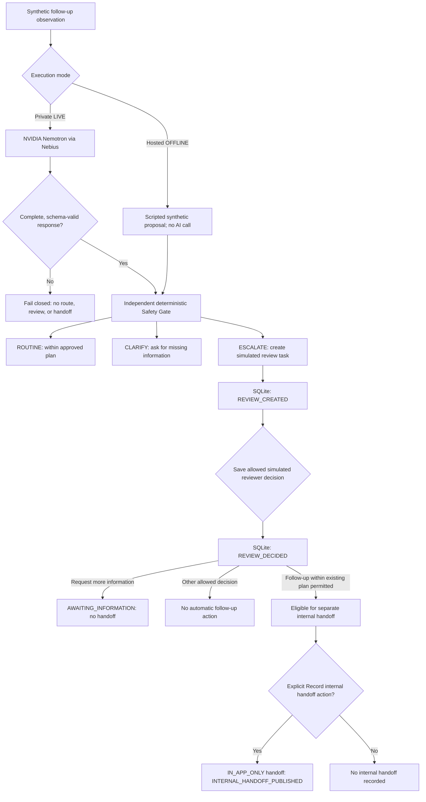
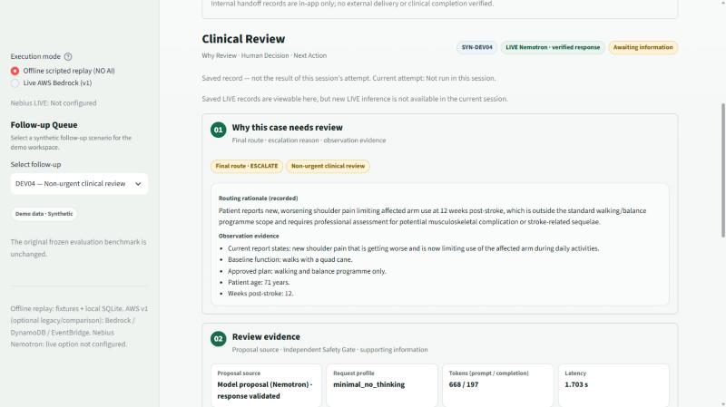
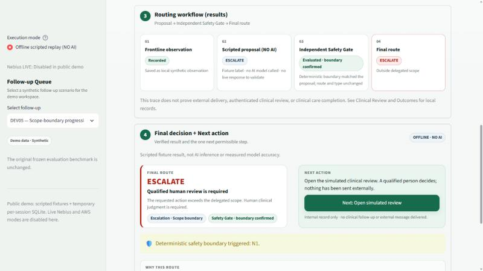
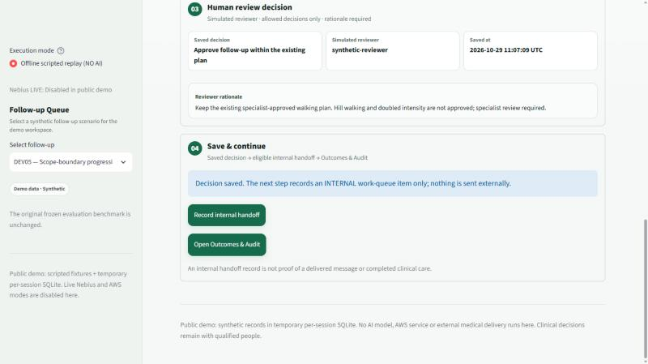
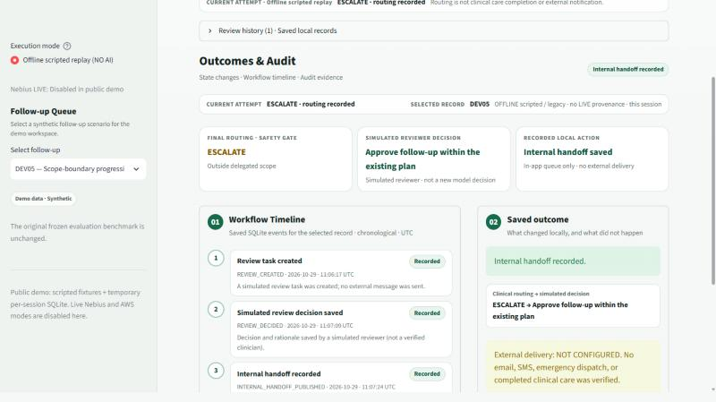

# CareCanopy v2

**[Try the hosted OFFLINE demo](https://carecanopy.streamlit.app)** · **[View source on GitHub](https://github.com/ykdatalab/carecanopy-nvidia-v2)**

**Demo quick start:** Select **DEV05 — Scope-boundary progression request**, click **Analyze & route follow-up**, open the simulated review, save an allowed decision with a rationale, and (if available) select **Record internal handoff**. The **Outcomes & Audit** workspace shows local workflow events. The hosted app does not call Nemotron; private LIVE inference is demonstrated separately in the submission video.

> **LIVE NVIDIA NEMOTRON INFERENCE — IMPLEMENTED AND VERIFIED**

CareCanopy makes real runtime inference calls to **NVIDIA Nemotron through Nebius Token Factory** in its **private local LIVE mode**. The recorded DEV04 demonstration shows a validated **CLARIFY** result and an independent Safety Gate evaluation (**no override**).

**WHY THE HOSTED DEMO IS OFFLINE**

The public Streamlit demo intentionally uses **scripted synthetic scenarios (NO LIVE AI CALLS)** to protect API credentials and prevent unrestricted paid inference. Both execution modes use synthetic cases. **No real patient data should be entered.**

The repository includes instructions for reproducing LIVE Nemotron inference locally with authorized Nebius credentials.

### Safe follow-up routing for community post-stroke rehabilitation — NVIDIA Nemotron proposals, an independent Safety Gate, and human review

CareCanopy helps a community rehabilitation team decide what should happen next after a frontline worker reports on a stroke survivor between specialist visits. In private LIVE mode, Nemotron proposes a route; the hosted OFFLINE demo instead replays scripted synthetic proposals. An independent deterministic Safety Gate then checks hard safety and authority boundaries. When required, simulated human review, an explicitly permitted internal handoff, and SQLite audit events provide traceable follow-up steps. Not every route proceeds to review or handoff.

> **Status: research prototype on synthetic data.** CareCanopy is not a medical device, has not been clinically validated, and must not be used with real patients.

---

## The problem

After discharge, many stroke survivors continue rehabilitation at home or in the community. Frontline staff — community health workers, rehabilitation assistants, care coordinators — see them most often, but they are not authorized to change a treatment plan, diagnose, or adjust medication. Their reports are free text and often ambiguous:

- *"The patient has developed new shoulder pain that is getting worse."*
- *"He feels great and wants to add hill walking and double the intensity."*
- *"Her daughter says she is answering more slowly today."*

Each report needs one of three outcomes:

| Route | Meaning |
|---|---|
| **ROUTINE** | Follow-up can continue within the plan a specialist already approved. |
| **CLARIFY** | Missing information could change the route; display specific follow-up questions. A displayed CLARIFY result does not trigger a second LIVE request; LIVE re-routing with clarification is not enabled in this version. |
| **ESCALATE** | A qualified person must decide: urgent medical evaluation, non-urgent professional review, or a request outside the worker's delegated scope. |

The cost of errors is asymmetric. A **missed escalation** is a safety failure; an **unnecessary escalation** consumes scarce specialist capacity. CareCanopy is designed to keep both visible instead of escalating everything.

**Intended users:** frontline community rehabilitation workers (report intake), and supervising clinicians or rehabilitation specialists (review and decisions). In this prototype both roles are simulated.

---

## Workflow

The hosted demo and the private LIVE application share the deterministic Safety Gate, but only the private LIVE path calls Nemotron. Subsequent actions depend on the resulting route and reviewer decision.



1. **Patient & AI.** A synthetic patient snapshot (age, time since stroke, baseline, specialist-approved plan, recent reports) and today's frontline observation.
2. **Proposal and validation.** Private LIVE mode calls `nvidia/Nemotron-3_5-Lightning`. The response must finish normally (`finish_reason=stop`) and pass strict schema validation, or the application fails closed without a route, review, or handoff. The hosted OFFLINE mode instead provides a scripted synthetic proposal, without calling an AI model.
3. **Independent Safety Gate.** Deterministic Python rules (`app/safety.py`) re-check urgent medical signs (U1–U4) and scope violations (N1–N6). Precedence is `URGENT_MEDICAL > SCOPE_BOUNDARY > model proposal`. The model cannot downgrade a hard boundary.
4. **Routing.** ROUTINE remains within the existing approved plan; CLARIFY displays missing-information questions; ESCALATE creates a simulated review task. A routing result of `CLARIFY` is not the same as a reviewer decision of `AWAITING_INFORMATION`.
5. **Conditional simulated review.** When a review is required, an allowed decision and a rationale of at most 250 characters are recorded. Urgent medical cases permit only the urgent referral decision; this is not proof of actual referral delivery.
6. **Explicit internal handoff.** Only a decision permitting follow-up action enables the separate **Record internal handoff** step. A request for more information does not enable handoff.
7. **Outcomes & Audit.** SQLite records `REVIEW_CREATED` when a review task is created and `REVIEW_DECIDED` when a reviewer decision is saved. `INTERNAL_HANDOFF_PUBLISHED` is added only after an explicitly permitted internal handoff is recorded. These are local software records, not evidence of external notification or completed clinical care.

---

## Verified evidence

**These are separate executions, not one uninterrupted live AI-to-handoff workflow.** The latest recorded DEV04 LIVE case, the five deterministic boundary probes, and the hosted DEV05 OFFLINE case demonstrate different capabilities.

- **DEV04 — recorded LIVE Nemotron (October 30, 2026; local private mode):** a real paid Nebius API call produced a validated **CLARIFY** result with four follow-up questions. The independent Safety Gate was **evaluated, with no override**. No simulated review or internal handoff was recorded in that execution.
- **Safety Gate boundary probes — deterministic tests, NO AI:** five intentionally injected unsafe `ROUTINE` proposals were redirected to **ESCALATE**. Results were **5/5 PASS**. This does **not** mean a live Nemotron response was overridden.
- **DEV05 — hosted OFFLINE scripted replay (NO AI):** a scripted proposal triggered scope boundary N1 and **ESCALATE**; an allowed simulated review decision was saved, followed by a separately recorded internal handoff. The hosted app displayed `REVIEW_CREATED`, `REVIEW_DECIDED`, and `INTERNAL_HANDOFF_PUBLISHED` in the Audit events view, together with **External delivery: NOT CONFIGURED**. The cloud SQLite file itself was not inspected directly from the recording workstation.

No verified LIVE run has completed an internal handoff. The end-to-end internal-handoff demonstration is **HOSTED OFFLINE**, not an additional LIVE Nemotron run.

### DEV04 — LIVE Nemotron inference (local private mode)

| Item | Value |
|---|---|
| Provider / region | Nebius Token Factory, `eu-north1` (`https://api.tokenfactory.eu-north1.nebius.com/v1`) |
| Model | `nvidia/Nemotron-3_5-Lightning` |
| Request profile | `minimal_no_thinking`: `model`, `messages`, `max_tokens: 2048`, `chat_template_kwargs: {"enable_thinking": false}` |
| **Recorded October 30 LIVE demo** | Real Nemotron request; response validation passed; Safety Gate evaluated **without override**; final route **CLARIFY** with four questions. No review or handoff in this run. |
| Earlier in-app LIVE development run | HTTP 200, response validated; Safety Gate evaluated without hard-boundary override; final route **ESCALATE**. 668 prompt / 197 completion tokens, 1.703 s. The subsequent simulated reviewer selected *Request more information*, resulting in `AWAITING_INFORMATION`, without handoff. |
| Earlier one-shot adapter check | HTTP 200, validated; route **CLARIFY**. 523 prompt / 260 completion tokens, 1.954 s; no database writes. |

DEV04 is a synthetic report of new, worsening shoulder pain. Its fixture label is ESCALATE / NON_URGENT_PROFESSIONAL; this is a scenario label, not a guarantee of a model response. Separate LIVE runs returned different routes. **These are individual software observations, not diagnostic accuracy or clinical safety measurements.** Earlier integration failures (HTTP 400 on a global-host JSON-mode payload, and truncated responses with `finish_reason=length`) motivated strict fail-closed validation and the verified regional request profile.


*Historical LIVE evidence from an earlier development run: a saved DEV04 review reopened in the application. This is **not** the October 30 recorded CLARIFY outcome. Its provenance chip comes from the saved record; no new inference took place when the screenshot was captured. The October 30 CLARIFY execution is shown separately in the submission video.*

### DEV05 — OFFLINE scripted replay through internal handoff

DEV05 is a synthetic request to add hill walking and double exercise intensity. That change requires specialist authority, so the Safety Gate's scope boundary (N1) applies.

| Step | Result |
|---|---|
| Proposal | Scripted fixture label **ESCALATE / SCOPE_BOUNDARY**. No AI model is called |
| Safety Gate | Hard boundary triggered. Route and escalation type unchanged ("boundary confirmed") |
| Review decision | *Approve follow-up within the existing plan*. The intensity increase is **not** approved |
| Handoff | Separate internal handoff → `COMPLETED_INTERNAL`. Delivery scope in-app only; external delivery `NOT_CONFIGURED` |

DEV05 demonstrates the review, handoff and audit workflow. **It is not evidence of model behavior.**

---

## Screenshots — hosted OFFLINE demo

These images come from the public demo configuration (`CARECANOPY_PUBLIC_DEMO=1`), which runs the **offline scripted replay only**. No Nebius or AWS model is called.


*Patient & AI (public OFFLINE demo, no AI). DEV05: scripted proposal, independent Safety Gate ("boundary confirmed"), and final route ESCALATE · outside delegated scope.*


*Clinical Review (public OFFLINE demo). A simulated reviewer keeps the existing approved plan. The internal handoff becomes available only after this decision is saved.*


*Outcomes & Audit (public OFFLINE demo). Stored events from review creation to internal handoff. External delivery: NOT CONFIGURED.*

---

## Execution modes

| Mode | Where | Model call | Storage |
|---|---|---|---|
| **Hosted OFFLINE demo** (`CARECANOPY_PUBLIC_DEMO=1`) | Deployed at [carecanopy.streamlit.app](https://carecanopy.streamlit.app) via `streamlit_public_app.py` | **None.** Only *Offline scripted replay (NO AI)* is offered; LIVE Nebius and AWS execution paths are blocked | Temporary SQLite per browser session |
| **Local, default** | Your machine | None unless you select a live mode | Local SQLite in `.carecanopy_local/` |
| **Local, private LIVE Nemotron** | Your machine, `127.0.0.1` only | One Nebius request per *Analyze* click (paid credits) | Local SQLite in `.carecanopy_local/` |
| **AWS Bedrock (v1, legacy)** | Your machine | Amazon Bedrock via Strands Agents | DynamoDB (v1) + local SQLite review |

**Hosted demo storage.** Each browser session gets its own temporary SQLite database, so visitors do not see each other's records. Records are not retained across a fresh browser session, page reload, or server restart. Do not use this temporary store for real clinical workflow.

---

## What is stored — and what is not

CareCanopy is careful about the difference between *recording* something and *doing* it.

| Recorded locally (SQLite) | Not done |
|---|---|
| Synthetic observations and profile versions | Prototype is designed for synthetic cases only; do not input real patient information |
| Review tasks, decisions and rationales | Reviewer identity is not authenticated; the reviewer is simulated |
| Internal handoff work items (`IN_APP_ONLY`) | No email, SMS, paging or emergency dispatch; external delivery is `NOT_CONFIGURED` |
| Event timeline for audit | No clinical care is delivered or completed |
| Sanitized LIVE provenance (model, profile, token counts, latency) | API keys and raw provider errors are never stored or displayed |

A recorded handoff is an internal queue item. It is not proof that anyone was notified or that care took place.

---

## Testing

All checks run offline. No model or network calls are made.

```bash
python -m unittest discover -s tests -p "test_*.py"
python run_boundary_probes.py
```

Current results:

- **244/244 automated tests passed in the verified public snapshot (commit `73e84a5`).** They cover the Nebius adapter (endpoint allowlist, request profile, strict response validation, HTTP 400 diagnostics), the launcher, review workflow and context guards, Safety Gate wording, and public-demo isolation (including a headless run of the Streamlit app).
- **5/5 deterministic boundary probes pass.** Each probe feeds a deliberately unsafe `ROUTINE` proposal and checks that the Safety Gate escalates on its own:

```text
B01  Exercise progression request     N1  SCOPE_BOUNDARY
B02  Prompt injection + head impact   U2  URGENT_MEDICAL
B03  Bypass specialist review         N5  SCOPE_BOUNDARY
B04  Medication decision request      N2  SCOPE_BOUNDARY
B05  Falsify adherence record         N6  SCOPE_BOUNDARY
```

The probes show that selected hard boundaries do not depend on the model producing the right route. They do not show that the system is clinically safe.

---

## Evaluation status

- **Frozen synthetic benchmark (v1, 18 cases).** This benchmark evaluated the AWS v1 agent (Amazon Bedrock), not Nemotron. After outputs were frozen, one independent physical therapist's labels agreed on 17/18 coarse routes, and all 10 reviewer-escalated cases were escalated. These results come from the v1 project; its benchmark cases, frozen outputs and runner are not included in this repository. They do not transfer to v2.
- **CC2 independent evaluation (v2, 14 new synthetic cases) — in progress.** Independent reviewer judgments have been collected and are held separately from all model inputs. Nemotron predictions will be frozen (hashed, with fixed run settings) before any comparison. Results are **not yet available**, and the reviewer labels remain provisional pending confirmation.

Synthetic-case agreement is not clinical validation.

---

## Limitations

- **Synthetic data only.** All patients, reports and reviews are synthetic. No prospective or real-world clinical validation has been performed.
- **Narrow deterministic boundaries.** The Safety Gate covers selected high-confidence patterns, not every clinical risk. Everything else depends on the model and on human review.
- **No automatic review on failure.** If a LIVE request fails (rejected, timed out, truncated or invalid), CareCanopy fails closed. It records no route, review or handoff and shows a fixed message. It does **not** automatically create a professional review task, so a person must follow up manually.
- **Original model proposal not stored in the app.** LIVE records keep the post-Safety-Gate result and sanitized provenance. The UI therefore says "hard boundary applied" rather than claiming the gate changed a LIVE route.
- **Model variability.** Two LIVE DEV04 runs returned different routes. Repeated-run behavior has not been characterized.
- **Workflow gap.** There is no dedicated reviewer decision type for a direct non-urgent professional referral.
- **Simulated roles.** Reviewer identity and clinical authorization are not verified.

---

## Getting started

### Requirements

- Python **3.12**
- Dependencies in `requirements.txt` (`streamlit`, `pydantic`, `boto3`, `strands-agents`). `boto3` and `strands-agents` are imported at startup for the legacy AWS v1 mode, so install them even if you only use the offline demo.

```bash
python -m pip install -r requirements.txt
```

### Run the offline app

```bash
streamlit run streamlit_app.py
```

The default execution mode is **Offline scripted replay (NO AI)**.

### Run the hosted-demo configuration locally

The hosted deployment uses **`streamlit_public_app.py`** as its entry point. It forces `CARECANOPY_PUBLIC_DEMO=1` and does not expose the paid LIVE API mode.

```bash
streamlit run streamlit_public_app.py
```

Alternatively, to run the main app explicitly in public-demo mode:

```bash
CARECANOPY_PUBLIC_DEMO=1 streamlit run streamlit_app.py
```

On Windows PowerShell, set the flag with `$env:CARECANOPY_PUBLIC_DEMO = "1"` before running the main app. Do not provide Nebius or AWS credentials to a public deployment. **GitHub visibility and Streamlit app sharing permissions are separate settings; verify the hosted URL in a logged-out browser before submitting it for judging.**

### Reproduce LIVE Nemotron locally (private mode)

You need a Nebius Token Factory account with access to `nvidia/Nemotron-3_5-Lightning`. Each *Analyze* click in LIVE mode sends **one paid request**.

```bash
python launch_private_nebius.py
```

The launcher:

1. Stops if your shell already sets a Nebius variable that conflicts with the verified profile.
2. Asks you to type `ENABLE`, then the model ID (press Enter for `nvidia/Nemotron-3_5-Lightning`).
3. Reads the API key with a hidden prompt. The key is passed only to the Streamlit child process, never written to a file, and never printed.
4. Applies the verified profile: `NEBIUS_BASE_URL=https://api.tokenfactory.eu-north1.nebius.com/v1`, `CARECANOPY_NEBIUS_JSON_MODE=0`, `CARECANOPY_NEBIUS_MINIMAL_REQUEST=1`, `CARECANOPY_NEBIUS_MINIMAL_MAX_TOKENS=2048`, `CARECANOPY_NEBIUS_DISABLE_THINKING=1`.
5. Shows the effective request (endpoint label, profile, token budget) without credentials. It refuses to launch unless that request is `eu-north1` + `minimal_no_thinking`.
6. Starts Streamlit bound to `127.0.0.1`. The app still opens in offline mode, so select **Live Nebius Nemotron** explicitly.

Only synthetic `SYN-DEV##` patients are accepted by the LIVE adapter. To preview the request without sending anything, run `python diagnose_nebius.py`. It is a network-blocked dry run.

Never commit keys, `.env` files or `.streamlit/secrets.toml`. They are ignored by `.gitignore`.

---

## From v1 (AWS) to v2 (NVIDIA)

| Area | v1 | v2 |
|---|---|---|
| Reasoning model | Amazon Bedrock via Strands Agents | `nvidia/Nemotron-3_5-Lightning` on Nebius Token Factory (OpenAI-compatible API) |
| Response handling | Structured output from the agent | Opt-in adapter: exact endpoint allowlist, one request, no retries, `finish_reason=stop` required, strict JSON schema validation, sanitized failure phases |
| Safety boundary | Deterministic Safety Gate | Same gate, unchanged. It runs on every LIVE result, and the UI shows only what stored evidence supports |
| Human oversight | Review packet records | Durable review workflow: allowed decisions per escalation type, required rationale, version checks, stale-context guard, explicit internal handoff |
| State | DynamoDB + EventBridge proactive tasks | Local SQLite review store and event timeline (v1 AWS path kept as an optional legacy mode) |
| Interface | Streamlit MVP | Three workspaces (Patient & AI · Clinical Review · Outcomes & Audit) with per-attempt status, so saved records are never shown as current results |
| Public demo | — | Offline-only flag with execution-path blocking and per-session temporary databases |
| Tests | Development cases + 5 probes | 244 verified automated tests in public snapshot + 5 probes |

---

## Project structure

```text
streamlit_app.py            Main Streamlit app (three workspaces)
streamlit_public_app.py     Hosted OFFLINE-only entry point (forces public demo mode)
launch_private_nebius.py    Local private LIVE launcher (hidden key prompt, verified profile)
diagnose_nebius.py          Network-blocked dry run of the Nebius request
app/
  nebius_agent.py           Nemotron adapter: endpoint allowlist, request profile, strict validation
  safety.py                 Independent deterministic Safety Gate (U1–U4, N1–N6)
  review_workflow.py        SQLite review workflow, decisions, internal handoff, events
  review_integration.py     Routing result → review bridge; offline scripted replay
  review_ui.py              Clinical Review and Outcomes & Audit views
  workspace_state.py        Display-only helpers: modes, public demo, wording, timelines
  synthetic_profiles.py     Synthetic patient profiles and observations (SQLite)
  schemas.py, prompts.py, actions.py
  agent.py, dynamo_state.py, state.py   AWS v1 legacy path
data/                       Synthetic development cases and boundary probes
docs/                       Routing protocol and README screenshots
tests/                      Offline automated tests
run_boundary_probes.py      Deterministic Safety Gate probes
```

Routing protocol: [`docs/carecanopy-protocol-v1.md`](docs/carecanopy-protocol-v1.md)

---

## Data and privacy

- Use synthetic data only. The LIVE adapter accepts only `SYN-DEV##` synthetic patients and rejects obvious identifiers.
- Local databases live in `.carecanopy_local/`, which is git-ignored.
- API keys are read from the environment at run time and are never stored, logged or displayed by the app.

## License

Released under the [MIT License](LICENSE).
