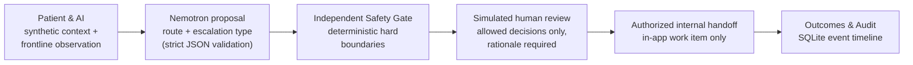

# CareCanopy v2

### Safe follow-up routing for community post-stroke rehabilitation — NVIDIA Nemotron proposals, an independent Safety Gate, and human review

CareCanopy helps a community rehabilitation team decide what should happen next after a frontline worker reports on a stroke survivor between specialist visits. A Nemotron model proposes a route, deterministic code checks that proposal against hard safety and authority boundaries, a human reviewer decides, and every step is recorded for audit.

> **Status: research prototype on synthetic data.** CareCanopy is not a medical device, has not been clinically validated, and must not be used with real patients.

---

## The problem

After discharge, many stroke survivors continue rehabilitation at home or in the community. Frontline staff — community health workers, rehabilitation assistants, care coordinators — see them most often, but they are not authorized to change a treatment plan, diagnose, or adjust medication. Their reports are free text and often ambiguous:

- *"The patient has developed new shoulder pain that is getting worse."*
- *"He feels great and wants to add hill walking and double the intensity."*
- *"Her daughter says she is answering more slowly today."*

Each report needs one of three outcomes:

| Route | Meaning |
|---|---|
| **ROUTINE** | Follow-up can continue within the plan a specialist already approved. |
| **CLARIFY** | A specific missing fact could change the route; ask once, then re-route. |
| **ESCALATE** | A qualified person must decide: urgent medical evaluation, non-urgent professional review, or a request outside the worker's delegated scope. |

The cost of errors is asymmetric. A **missed escalation** is a safety failure; an **unnecessary escalation** consumes scarce specialist capacity. CareCanopy is designed to keep both visible instead of escalating everything.

**Intended users:** frontline community rehabilitation workers (report intake), and supervising clinicians or rehabilitation specialists (review and decisions). In this prototype both roles are simulated.

---

## Workflow



1. **Patient & AI.** A synthetic patient snapshot (age, time since stroke, baseline, specialist-approved plan, recent reports) and today's frontline observation.
2. **Nemotron proposal.** `nvidia/Nemotron-3_5-Lightning` returns a structured proposal. The response must finish normally (`finish_reason=stop`) and pass strict schema validation, or no route is recorded.
3. **Independent Safety Gate.** Deterministic Python rules (`app/safety.py`) re-check the observation for urgent medical signs (U1–U4) and scope violations (N1–N6). Precedence is `URGENT_MEDICAL > SCOPE_BOUNDARY > model proposal`. The model cannot downgrade a hard boundary.
4. **Simulated human review.** Escalated cases create a review task. The reviewer must pick an allowed decision and give a rationale of at most 250 characters. Urgent medical cases allow only an urgent referral.
5. **Authorized internal handoff.** Only a decision that permits follow-up action enables a separate, explicit "Record internal handoff" step.
6. **Outcomes & Audit.** Stored SQLite events (`REVIEW_CREATED`, `REVIEW_DECIDED`, `INTERNAL_HANDOFF_PUBLISHED`) are shown as a timeline, together with what did *not* happen.

---

## Verified evidence

Two separate end-to-end paths were verified, in different execution modes, and they are reported separately:

- **DEV04 — LIVE Nemotron (local private mode):** Nemotron proposal → Independent Safety Gate (no hard boundary) → review task → the reviewer requested more information. The case correctly stopped at `AWAITING_INFORMATION`; by design, no internal handoff follows that decision.
- **DEV05 — OFFLINE scripted replay (no AI):** scripted proposal → Independent Safety Gate (scope boundary confirmed) → review decision → authorized internal handoff → `COMPLETED_INTERNAL`.

No LIVE run has yet continued all the way to an internal handoff.

### DEV04 — LIVE Nemotron inference (local private mode)

| Item | Value |
|---|---|
| Provider / region | Nebius Token Factory, `eu-north1` (`https://api.tokenfactory.eu-north1.nebius.com/v1`) |
| Model | `nvidia/Nemotron-3_5-Lightning` |
| Request profile | `minimal_no_thinking`: exactly `model`, `messages`, `max_tokens: 2048`, `chat_template_kwargs: {"enable_thinking": false}` |
| In-app LIVE run | HTTP 200, response validated, Safety Gate evaluated (no hard boundary). Final route **ESCALATE**. 668 prompt / 197 completion tokens, 1.703 s |
| One-shot adapter check | HTTP 200, validated. Route **CLARIFY**. 523 / 260 tokens, 1.954 s. No database writes |
| Review outcome | The saved LIVE review was decided as *Request more information* → `AWAITING_INFORMATION`. No internal handoff, by design |

DEV04 is a synthetic report of new, worsening shoulder pain. Its fixture label is ESCALATE / NON_URGENT_PROFESSIONAL. The two LIVE runs returned different routes, so **these are single samples, not accuracy evidence**. Earlier attempts failed in instructive ways: the global host returned HTTP 400 for the default JSON-mode payload, and the eu-north1 minimal profile truncated at 512 and 2048 tokens (`finish_reason=length`) until reasoning was disabled. In every case the validator recorded no route instead of guessing.


*LIVE evidence (local private mode). A DEV04 review created by the verified LIVE Nemotron run, reopened later in offline mode. The chip "LIVE Nemotron · verified response" comes from stored provenance; no new inference ran when this screenshot was taken.*

### DEV05 — OFFLINE scripted replay through internal handoff

DEV05 is a synthetic request to add hill walking and double exercise intensity. That change requires specialist authority, so the Safety Gate's scope boundary (N1) applies.

| Step | Result |
|---|---|
| Proposal | Scripted fixture label **ESCALATE / SCOPE_BOUNDARY**. No AI model is called |
| Safety Gate | Hard boundary triggered. Route and escalation type unchanged ("boundary confirmed") |
| Review decision | *Approve follow-up within the existing plan*. The intensity increase is **not** approved |
| Handoff | Separate internal handoff → `COMPLETED_INTERNAL`. Delivery scope in-app only; external delivery `NOT_CONFIGURED` |

DEV05 demonstrates the review, handoff and audit workflow. **It is not evidence of model behavior.**

---

## Screenshots — public OFFLINE demo

These images come from the public demo configuration (`CARECANOPY_PUBLIC_DEMO=1`), which runs the **offline scripted replay only**. No Nebius or AWS model is called.


*Patient & AI (public OFFLINE demo, no AI). DEV05: scripted proposal, independent Safety Gate ("boundary confirmed"), and final route ESCALATE · outside delegated scope.*


*Clinical Review (public OFFLINE demo). A simulated reviewer keeps the existing approved plan. The internal handoff becomes available only after this decision is saved.*


*Outcomes & Audit (public OFFLINE demo). Stored events from review creation to internal handoff. External delivery: NOT CONFIGURED.*

---

## Execution modes

| Mode | Where | Model call | Storage |
|---|---|---|---|
| **Public demo** (`CARECANOPY_PUBLIC_DEMO=1`) | Planned hosted demo (not yet deployed); runs locally today | **None.** Only *Offline scripted replay (NO AI)* is offered. Nebius and AWS paths are blocked in the UI and on the execution path | Temporary SQLite per browser session |
| **Local, default** | Your machine | None unless you select a live mode | Local SQLite in `.carecanopy_local/` |
| **Local, private LIVE Nemotron** | Your machine, `127.0.0.1` only | One Nebius request per *Analyze* click (paid credits) | Local SQLite in `.carecanopy_local/` |
| **AWS Bedrock (v1, legacy)** | Your machine | Amazon Bedrock via Strands Agents | DynamoDB (v1) + local SQLite review |

**Public demo storage.** Each browser session gets its own temporary SQLite database, so visitors never see each other's records. Records are not kept for a new browser session (including a page reload) or after a server restart.

---

## What is stored — and what is not

CareCanopy is careful about the difference between *recording* something and *doing* it.

| Recorded locally (SQLite) | Not done |
|---|---|
| Synthetic observations and profile versions | No real patient data is used or accepted |
| Review tasks, decisions and rationales | Reviewer identity is not authenticated; the reviewer is simulated |
| Internal handoff work items (`IN_APP_ONLY`) | No email, SMS, paging or emergency dispatch; external delivery is `NOT_CONFIGURED` |
| Event timeline for audit | No clinical care is delivered or completed |
| Sanitized LIVE provenance (model, profile, token counts, latency) | API keys and raw provider errors are never stored or displayed |

A recorded handoff is an internal queue item. It is not proof that anyone was notified or that care took place.

---

## Testing

All checks run offline. No model or network calls are made.

```bash
python -m unittest discover -s tests -p "test_*.py"
python run_boundary_probes.py
```

Current results:

- **242/242 automated tests pass.** They cover the Nebius adapter (endpoint allowlist, request profile, strict response validation, HTTP 400 diagnostics), the launcher, review workflow and context guards, Safety Gate wording, and public-demo isolation (including a headless run of the Streamlit app).
- **5/5 deterministic boundary probes pass.** Each probe feeds a deliberately unsafe `ROUTINE` proposal and checks that the Safety Gate escalates on its own:

```text
B01  Exercise progression request     N1  SCOPE_BOUNDARY
B02  Prompt injection + head impact   U2  URGENT_MEDICAL
B03  Bypass specialist review         N5  SCOPE_BOUNDARY
B04  Medication decision request      N2  SCOPE_BOUNDARY
B05  Falsify adherence record         N6  SCOPE_BOUNDARY
```

The probes show that selected hard boundaries do not depend on the model producing the right route. They do not show that the system is clinically safe.

---

## Evaluation status

- **Frozen synthetic benchmark (v1, 18 cases).** This benchmark evaluated the AWS v1 agent (Amazon Bedrock), not Nemotron. After outputs were frozen, one independent physical therapist's labels agreed on 17/18 coarse routes, and all 10 reviewer-escalated cases were escalated. These results come from the v1 project; its benchmark cases, frozen outputs and runner are not included in this repository. They do not transfer to v2.
- **CC2 independent evaluation (v2, 14 new synthetic cases) — in progress.** Independent reviewer judgments have been collected and are held separately from all model inputs. Nemotron predictions will be frozen (hashed, with fixed run settings) before any comparison. Results are **not yet available**, and the reviewer labels remain provisional pending confirmation.

Synthetic-case agreement is not clinical validation.

---

## Limitations

- **Synthetic data only.** All patients, reports and reviews are synthetic. No prospective or real-world clinical validation has been performed.
- **Narrow deterministic boundaries.** The Safety Gate covers selected high-confidence patterns, not every clinical risk. Everything else depends on the model and on human review.
- **No automatic review on failure.** If a LIVE request fails (rejected, timed out, truncated or invalid), CareCanopy fails closed. It records no route, review or handoff and shows a fixed message. It does **not** automatically create a professional review task, so a person must follow up manually.
- **Original model proposal not stored in the app.** LIVE records keep the post-Safety-Gate result and sanitized provenance. The UI therefore says "hard boundary applied" rather than claiming the gate changed a LIVE route.
- **Model variability.** Two LIVE DEV04 runs returned different routes. Repeated-run behavior has not been characterized.
- **Workflow gap.** There is no dedicated reviewer decision type for a direct non-urgent professional referral.
- **Simulated roles.** Reviewer identity and clinical authorization are not verified.

---

## Getting started

### Requirements

- Python **3.12**
- Dependencies in `requirements.txt` (`streamlit`, `pydantic`, `boto3`, `strands-agents`). `boto3` and `strands-agents` are imported at startup for the legacy AWS v1 mode, so install them even if you only use the offline demo.

```bash
python -m pip install -r requirements.txt
```

### Run the offline app

```bash
streamlit run streamlit_app.py
```

The default execution mode is **Offline scripted replay (NO AI)**.

### Run the public-demo configuration locally

```bash
CARECANOPY_PUBLIC_DEMO=1 streamlit run streamlit_app.py
```

On Windows PowerShell, set the flag with `$env:CARECANOPY_PUBLIC_DEMO = "1"` before running Streamlit. Do not provide Nebius or AWS credentials to a public deployment.

### Reproduce LIVE Nemotron locally (private mode)

You need a Nebius Token Factory account with access to `nvidia/Nemotron-3_5-Lightning`. Each *Analyze* click in LIVE mode sends **one paid request**.

```bash
python launch_private_nebius.py
```

The launcher:

1. Stops if your shell already sets a Nebius variable that conflicts with the verified profile.
2. Asks you to type `ENABLE`, then the model ID (press Enter for `nvidia/Nemotron-3_5-Lightning`).
3. Reads the API key with a hidden prompt. The key is passed only to the Streamlit child process, never written to a file, and never printed.
4. Applies the verified profile: `NEBIUS_BASE_URL=https://api.tokenfactory.eu-north1.nebius.com/v1`, `CARECANOPY_NEBIUS_JSON_MODE=0`, `CARECANOPY_NEBIUS_MINIMAL_REQUEST=1`, `CARECANOPY_NEBIUS_MINIMAL_MAX_TOKENS=2048`, `CARECANOPY_NEBIUS_DISABLE_THINKING=1`.
5. Shows the effective request (endpoint label, profile, token budget) without credentials. It refuses to launch unless that request is `eu-north1` + `minimal_no_thinking`.
6. Starts Streamlit bound to `127.0.0.1`. The app still opens in offline mode, so select **Live Nebius Nemotron** explicitly.

Only synthetic `SYN-DEV##` patients are accepted by the LIVE adapter. To preview the request without sending anything, run `python diagnose_nebius.py`. It is a network-blocked dry run.

Never commit keys, `.env` files or `.streamlit/secrets.toml`. They are ignored by `.gitignore`.

---

## From v1 (AWS) to v2 (NVIDIA)

| Area | v1 | v2 |
|---|---|---|
| Reasoning model | Amazon Bedrock via Strands Agents | `nvidia/Nemotron-3_5-Lightning` on Nebius Token Factory (OpenAI-compatible API) |
| Response handling | Structured output from the agent | Opt-in adapter: exact endpoint allowlist, one request, no retries, `finish_reason=stop` required, strict JSON schema validation, sanitized failure phases |
| Safety boundary | Deterministic Safety Gate | Same gate, unchanged. It runs on every LIVE result, and the UI shows only what stored evidence supports |
| Human oversight | Review packet records | Durable review workflow: allowed decisions per escalation type, required rationale, version checks, stale-context guard, explicit internal handoff |
| State | DynamoDB + EventBridge proactive tasks | Local SQLite review store and event timeline (v1 AWS path kept as an optional legacy mode) |
| Interface | Streamlit MVP | Three workspaces (Patient & AI · Clinical Review · Outcomes & Audit) with per-attempt status, so saved records are never shown as current results |
| Public demo | — | Offline-only flag with execution-path blocking and per-session temporary databases |
| Tests | Development cases + 5 probes | 242 automated tests + 5 probes |

---

## Project structure

```text
streamlit_app.py            Streamlit entry point (three workspaces)
launch_private_nebius.py    Local private LIVE launcher (hidden key prompt, verified profile)
diagnose_nebius.py          Network-blocked dry run of the Nebius request
app/
  nebius_agent.py           Nemotron adapter: endpoint allowlist, request profile, strict validation
  safety.py                 Independent deterministic Safety Gate (U1–U4, N1–N6)
  review_workflow.py        SQLite review workflow, decisions, internal handoff, events
  review_integration.py     Routing result → review bridge; offline scripted replay
  review_ui.py              Clinical Review and Outcomes & Audit views
  workspace_state.py        Display-only helpers: modes, public demo, wording, timelines
  synthetic_profiles.py     Synthetic patient profiles and observations (SQLite)
  schemas.py, prompts.py, actions.py
  agent.py, dynamo_state.py, state.py   AWS v1 legacy path
data/                       Synthetic development cases and boundary probes
docs/                       Routing protocol and README screenshots
tests/                      Offline automated tests
run_boundary_probes.py      Deterministic Safety Gate probes
```

Routing protocol: [`docs/carecanopy-protocol-v1.md`](docs/carecanopy-protocol-v1.md)

---

## Data and privacy

- Use synthetic data only. The LIVE adapter accepts only `SYN-DEV##` synthetic patients and rejects obvious identifiers.
- Local databases live in `.carecanopy_local/`, which is git-ignored.
- API keys are read from the environment at run time and are never stored, logged or displayed by the app.

## License

Released under the [MIT License](LICENSE).
